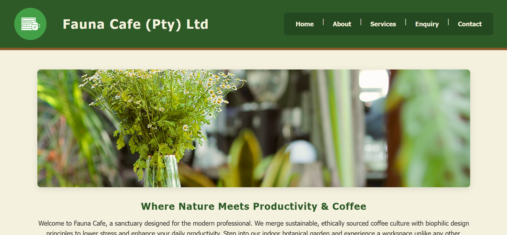
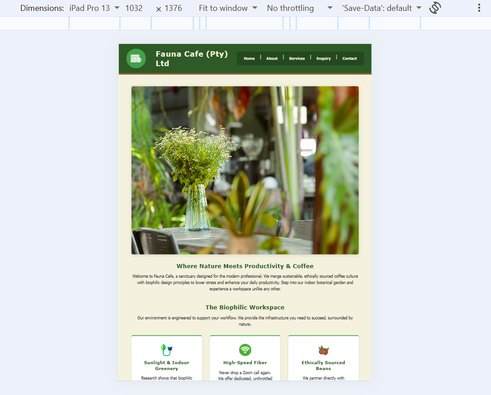
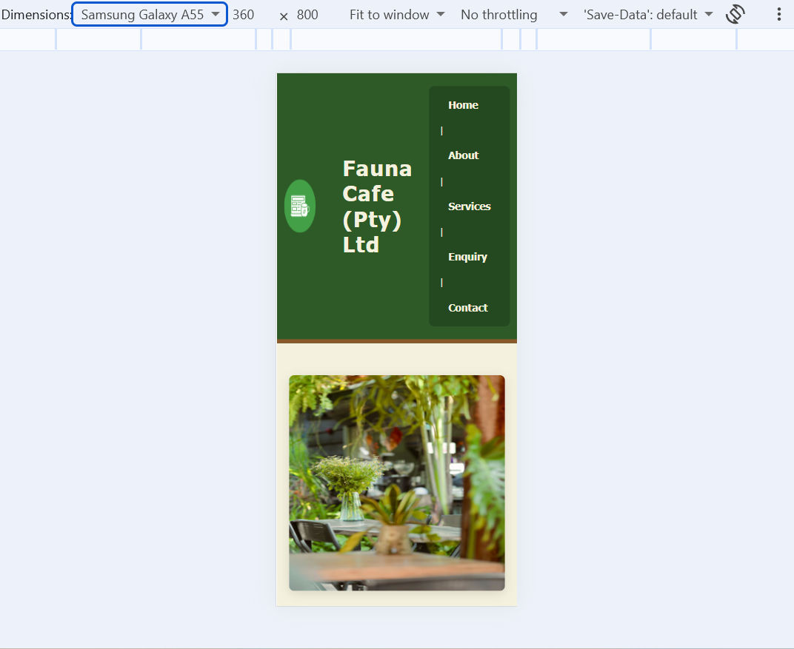

# Fauna Cafe (Pty) Ltd - WEDE5020 Portfolio of Evidence

## Student Information
* **Name:** Cyle Simmons
* **Student Number:** ST10543695

## Project Overview

Fauna Cafe (Pty) Ltd merges ethical coffee culture with biophilic design. The business provides sustainably sourced coffee, organic baked goods, and a dedicated, high-speed digital workspace. The primary target audience includes remote working professionals, university students, and artisanal coffee enthusiasts.

## Website Goals and Objectives

* Drive physical foot traffic, showcase the artisanal menu and streamline venue booking and catering inquiries.
* Achieve a target of 500 unique monthly visitors.
* Reach a 20% conversion rate on the online table-booking form.
* Generate a minimum of 5 catering inquiries per month.

## Key Features and Functionality (Amendments to be made) 

* Standard HTML5 layout
* Interactive image carousel, digital menu and workspace pricing table.
* HTML form for event booking and catering requests.
* Embedded map, operating hours, and direct contact details.

## Timeline and Milestones

* **Part 1:** Proposal finalisation and asset sourcing (August 2026).
* **Part 2:** HTML layout and CSS styling implementation (September 2026).
* Create styling sheet name 
* **Part 3:** Form validation, cross browser testing and deployment (October 2026).

## Part 1 Details

This commit covers the initial HTML5 page structure, directory setup, and image and content resources. 

## Part 2 Details

This update introduces the external CSS stylesheet (`styles.css`), implementing Flexbox and CSS Grid layouts, interactive pseudo-classes, and responsive media queries. It also includes updated HTML `<picture>` elements and screenshot evidence demonstrating responsive scaling across desktop, tablet, and mobile breakpoints.

## Site Map

* `index.html`: Hero image, value proposition, and quick-link navigation.
* `about.html`: The origin story, mission, and staff profiles.
* `services.html`: HTML table displaying the digital menu and workspace pricing.
* `enquiry.html`: HTML form for event booking and catering requests.
* `contact.html`: Embedded map, operating hours, and direct contact details.

## Part 3 Details

This final phase introduces interactive JavaScript capabilities and Search Engine Optimisation (SEO). 

* **Functionality:** Implemented a dynamic image lightbox on the services page, an interactive Leaflet.js map on the contact page, dynamic table filtering and strict form validation for the enquiry submission. 
* **SEO:** Added comprehensive meta descriptions, unique title tags, relevant keywords, a `robots.txt` file and an XML sitemap to ensure search engine visibility and correct crawler indexing.
* **Deployment:** The site is successfully deployed and hosted live via GitHub Pages.

## Changelog

**02 November 2026** 

* To map site structure for web crawlers `sitemap.xml` was created. 
* Repository set to public to accomodate GitHub Pages requirements. 
* Deployed the final web application to a live production environment using GitHub Pages. 

**24 October 2026** 

* Configured On-Page SEO by applying unique `<title>`, `<meta name="description">`, and `<meta name="keywords">` tags across all five HTML pages. 
* Created `robots.txt`  to define indexing rules. 

**23 October 2026** 

* Custom JavaScript (`scripts.js`) to validate the enquiry form, preventing default submission on empty or invalid inputs.

**12 October**

* Built a dynamic content search filter for the services table using `.includes()` and DOM manipulation.
* Updated services.html to accomodate the search function.
* Updated style.css to accomodate the search function.

**04 October 2026**

* Implemented an interactive image lightbox modal for the digital menu gallery proposed. 
* Integrated Leaflet.js and ArcGIS map tiles to render a fully interactive, location-based map for the Contact page.

**18 September 2026**

* Reviewed and refined all CSS lines and references to ensure consistency in regards to design, style and layout. 

**17 September 2026:**

* Utilised `display: flex` for navigation and `grid-template-areas` for the Contact page alignment.
* Media queries created for Tablet (900px) and Mobile (600px) breakpoints and implemented `<picture>` elements for responsive image loading.

**14 September 2026:**

* Created a central `styles.css` file and linked it across all HTML pages.
* Implemented a CSS reset and established a core biophilic color palette using CSS `:root` variables.\

**12 September 2026:** 

* Amended staff profiles section as per the proposal under the about section 

**10 September 2026:**

* Reviewed all HTML files to ensure proper closing tags and removed redundant inline attributes.
* Upgraded standard `
` containers to semantic HTML5 tags (e.g., `<article>`, `<section>`, `<address>`) to improve accessibility.

**22 August 2026:**

* Created project repository.
* Added base HTML structure for index, about, services, enquiry, and contact pages.
* Sourced and integrated image resources into the local directory.

**Screenshot Evidence:**

*(Below is the screenshot evidencing the responsive layout across different screen sizes and devices).*

### 1. Desktop View (1200px+)

### 2. Tablet View (1024px Breakpoint)

### 3. Mobile View (600px Breakpoint)

## Bibliography

* Figma, n.d. *Forest green*. [Online] Available at: Forest green [Accessed 15 August 2026].
* IBPA, n.d. *Biophilic design and color perception examples*. [Online] Available at: https://biophilicproducts.org/biophilic-design-blog/biophilic-design-color-perception-examples/ [Accessed 15 August 2026].
* Qays, 2023. *Mastering HTML5, CSS3, and JavaScript: A Comprehensive Guide for Web Developers*. [Online] Available at: https://www.ewrdigital.com/blog/mastering-html5-css3-javascript-guide-web-developers [Accessed 15 August 2026].
* Sakyi, F. N. O., 2022. *Developing KPI Frameworks to Enhance Accountability and Performance across Large-Scale Commercial Organizations*, s.l.: ResearchGate.
* Github Docs, n.d *Basic writing and formatting syntax*. [Online] Available at: https://docs.github.com/en/get-started/writing-on-github/getting-started-with-writing-and-formatting-on-github/basic-writing-and-formatting-syntax [Accessed 22 August 2026]
* GainLine, 2024. *Responsive Web Design: Techniques and Best Practices*. [Online] Available at: https://gainline.co.uk/insights/responsive-web-design-techniques-and-best-practices/ [Accessed 11 September 2026]
* FreeFrontend, n.d *CSS Examples*. [Online] Available at: https://freefrontend.com/css-code-examples/ [Accessed 11 September 2026]
* George, 2012 *Style Web Forms Using CSS*. [Online] Available at: https://www.sitepoint.com/style-web-forms-css/ [Accessed 13 September 2026]
* Basques and Emelianova, 2024. *Simulate mobile devices with device mode*. [Online] Available at: https://developer.chrome.com/docs/devtools/device-mode [Accessed 18 September 2026]
* W3schools, n.d. *How TO - Lightbox*. [Online] Availabile at: https://www.w3schools.com/howto/howto_js_lightbox.asp [Accessed 04 October 2026]
* Leaflet, n.d. *Leaflet Quick Start Guide*.  [Online] Availabile at: https://leafletjs.com/examples/quick-start/ [Accessed 04 October 2026]
* Leaflet, n.d. *Accessible maps*.  [Online] Availabile at: https://leafletjs.com/examples/accessibility/ [Accessed 04 October 2026]
* Matheson, 2024. *Embed your maps from Map Viewer with ease*. [Online] Availabile at: https://www.esri.com/arcgis-blog/products/arcgis-online/mapping/embed-2 [Accessed 04 October 2026]
* Geeksforgeek, 2026. *JavaScript DOM Manipulation*. [Online] Available at: https://www.geeksforgeeks.org/javascript/how-to-manipulate-dom-elements-in-javascript/ [Accessed 12 October 2026]
* Obgregon, 2023. *How to Build a Dynamic Search Feature with JavaScript Filters — A Quick Start Guide*. Available at: https://medium.com/@AlexanderObregon/how-to-build-a-dynamic-search-feature-with-javascript-filters-464b97038be1 [Accessed 12 October 2026]
* Geeksforgeek, 2026. *JavaScript Form Validation*. [Online] Available at: https://www.geeksforgeeks.org/javascript/form-validation-using-javascript/ [Accessed 12 October 2026]
* Obgregon, 2026. *Best Practices for SEO-friendly HTML5 Code — An Overview*. [Online] Available at: https://medium.com/@AlexanderObregon/best-practices-for-seo-friendly-html5-code-45130666be6e [Accessed 24 October 2026]
* Google Search Central, n.d. *Introduction to robots.txt*. [Online] Available at: https://developers.google.com/search/docs/crawling-indexing/robots/intro [Accessed 24 October 2026]
* Bulut, 2025. *Setting Up robots.txt and sitemap.xml Correctly for SEO and Hosting*. [Online] https://www.dchost.com/blog/en/setting-up-robots-txt-and-sitemap-xml-correctly-for-seo-and-hosting [Accessed 24 October 2026]

### Image references
* Pexels, n.d. *Swan latte art on cappuccino cup in istanbul cafe*. [Online] Available at: https://www.pexels.com/photo/swan-latte-art-on-cappuccino-cup-in-istanbul-cafe-36895623/ [Accessed 15 August 2026].
* Pexels, n.d. *A Man in White Long Sleeves Sitting on a Wooden Chair While Typing on His Laptop*. [Online] Available at: https://www.pexels.com/photo/a-man-in-white-long-sleeves-sitting-on-a-wooden-chair-while-typing-on-his-laptop-7255718/ [Accessed 15 August 2026].
* Pexels, n.d. *Coffees and Croissants on a Table*. [Online] Available at: https://www.pexels.com/photo/coffees-and-croissants-on-a-table-15801049/ [Accessed 15 August 2026].
* Pexels, n.d. *Cozy Outdoor Cafe Table with Floral Decor*. [Online] Available at: https://www.pexels.com/photo/cozy-outdoor-cafe-table-with-floral-decor-36516521/ [Accessed 15 August 2026].
* Flaticon, n.d. *Green energy icon*. [Online] Available at: https://www.flaticon.com/free-icon/green-energy_3381158?term=wifi+green&page=1&position=5&origin=search&related_id=3381158 [Accessed 22 August 2026].
* Flaticon, n.d. *Circle icon*. [Online] Available at: https://www.flaticon.com/free-icon/circle_14024896?term=wifi+green&page=1&position=1&origin=search&related_id=14024896 [Accessed 22 August 2026].
* Flaticon, n.d. *Coffee bean icon*. [Online] Available at: https://www.flaticon.com/free-icon/coffee-bean_8243960?term=coffee&page=1&position=83&origin=search&related_id=8243960 [Accessed 22 August 2026].
* Pexels, n.d. *female barista in beanie and apron resting chin on had*. [Online] Available at: https://www.pexels.com/photo/female-barista-in-beanie-and-apron-resting-chin-on-had-4350057/ [Accessed 12 September 2026].
* Pexels, n.d. *women wearing an apron*. [Online] Available at: https://www.pexels.com/photo/woman-wearing-an-apron-8426686/ [Accessed 12 September 2026].
 